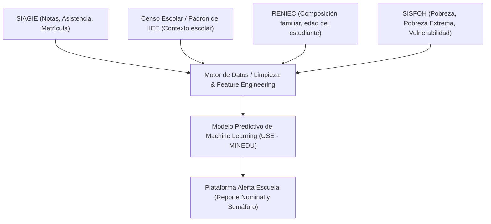
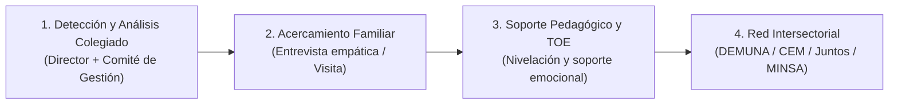

# Documentación Oficial y Técnica: Plataforma Alerta Escuela (MINEDU - Perú)

## 1. Ficha Técnica General

| Parámetro | Detalle |
| :--- | :--- |
| **Nombre Oficial** | Sistema de Alerta Temprana "Alerta Escuela" |
| **Entidad Rectora** | Ministerio de Educación del Perú (MINEDU) |
| **Órgano Desarrollador** | Secretaría de Planificación Estratégica (SPE) / Oficina de Seguimiento y Evaluación Estratégica (OSEE) / Unidad de Seguimiento y Evaluación (USE) |
| **Año de Lanzamiento** | 2020 (en el marco de la emergencia sanitaria y movilización por la continuidad educativa) |
| **Población Objetivo** | Estudiantes de Educación Básica Regular (Inicial, Primaria, Secundaria) y modalidades asociadas en colegios públicos y privados del Perú |
| **Usuarios del Sistema** | Directivos de Instituciones Educativas (II.EE.), docentes tutores, especialistas de UGEL y DRE |
| **Portal de Acceso** | `https://alertaescuela.minedu.gob.pe/` o a través del portal del **SIAGIE** (`http://siagie.minedu.gob.pe/`) |
| **Credenciales** | Mismo usuario y contraseña asignados al Director en el SIAGIE |

---

## 2. Propósito y Objetivos del Sistema

Alerta Escuela es una herramienta informática de soporte a las decisiones pedagógicas y de gestión escolar que utiliza **analítica predictiva y Machine Learning** para:
1. **Identificar de manera anticipada y nominal** a los estudiantes con alto, medio o bajo riesgo de interrumpir sus estudios (deserción escolar) o no matricularse en el siguiente periodo lectivo.
2. **Proveer orientaciones pedagógicas y de gestión escolar** adaptadas a los factores determinantes para que los equipos directivos y docentes implementen acciones preventivas antes del abandono efectivo.
3. **Monitorear y registrar el seguimiento periódico** de las intervenciones realizadas con las y los estudiantes y sus familias.

---

## 3. Marco Normativo y Legal

El funcionamiento, monitoreo y obligatoriedad de Alerta Escuela se sustenta en el marco institucional del MINEDU:

1. **RVM N° 212-2020-MINEDU** — *Lineamientos de Tutoría y Orientación Educativa (TOE) para la Educación Básica*:
   - Establece las bases del acompañamiento socioemocional, formativo y de proyecto de vida de los estudiantes.
   - Vincula las alertas de riesgo escolar con las sesiones y planes de tutoría individual y grupal.
2. **RVM N° 273-2020-MINEDU** y Resoluciones Anuales de Orientaciones para el Año Escolar (ej. **RM N° 474-2022-MINEDU**, **RM N° 587-2023-MINEDU**, **RM N° 556-2024-MINEDU**):
   - Instruyen formalmente a directores de II.EE. públicas y privadas a revisar periódicamente el módulo de Alerta Escuela.
   - Obligan a registrar el seguimiento mensual de estudiantes identificados con riesgo en el SIAGIE.
3. **Compromisos de Desempeño (CdD) anuales de DRE y UGEL**:
   - Mecanismo de incentivo financiero del MINEDU hacia los gobiernos regionales.
   - Incluyen metas explícitas de permanencia y retención interanual (en particular la transición primaria-secundaria y permanencia en secundaria) y porcentaje de II.EE. que hacen uso efectivo de Alerta Escuela.
4. **Guía para la Gestión Escolar en Instituciones y Programas Educativos de la Educación Básica**:
   - Marco de actuación de los Comités de Gestión Escolar (Comité de Gestión de Condiciones Operativas, Comité de Gestión Pedagógica y Comité de Gestión del Bienestar).

---

## 4. Fuentes de Datos e Integración de Sistemas

El sistema consolida información administrativa e intersectorial:



1. **SIAGIE (Sistema de Información de Apoyo a la Gestión de la Institución Educativa)**:
   - Trayectoria de matrícula histórica.
   - Calificaciones por áreas curriculares (competencias logradas, en proceso o en inicio - notas C/B/A/AD o escala numérica según corresponda).
   - Registros de asistencia y ausentismo.
2. **Padrón de Instituciones Educativas y Censo Escolar**:
   - Ubicación territorial (ruralidad 1, 2, 3; urbano; frontera; VRAEM).
   - Tipo de gestión (pública directa, convenio, privada).
   - Ratio docente/alumno y características de infraestructura y servicios básicos.
3. **Bases de datos externas (RENIEC y SISFOH)**:
   - Datos de edad del estudiante y padres.
   - Nivel de escolaridad del jefe de hogar / apoderado.
   - Condición socioeconómica del hogar (no pobre, pobre, pobre extremo).

---

## 5. Metodología del Modelo Predictivo (Machine Learning)

### 5.1 Enfoque Estadístico y Algoritmos
- **Paradigma**: Aprendizaje supervisado para clasificación binaria ($Y \in \{0, 1\}$), donde $Y=1$ denota que el estudiante interrumpe su trayectoria escolar en el periodo lectivo de referencia.
- **Modelos implementados**: Familias de algoritmos de ensambles basados en árboles de decisión (*Gradient Boosting / XGBoost* y *Random Forest*), comparados contra modelos base de regresión logística regularizada.
- **Validación del modelo**: Se entrena con históricos de cortes interanuales y se evalúa con curvas **ROC-AUC**, sensibilidad (*recall* para maximizar la detección de quienes realmente van a desertar) y precisión balanceada.

### 5.2 Variables Clave (Features)
El algoritmo procesa tres clústeres de variables:

1. **Factores Académicos e Individuales (Mayor peso predictivo)**:
   - **Atraso escolar / Extraedad**: Brecha entre la edad cronológica y la edad normativa del grado escolar cursado (uno de los predictores de mayor correlación con la deserción en Perú).
   - **Historial de repitencia o permanencia en el grado**.
   - **Bajo rendimiento previo**: Cantidad de asignaturas desaprobadas o con calificaciones en inicio ("C").
   - **Patrones de asistencia**: Ausentismo acumulado o intermitente en meses previos.
2. **Factores Sociodemográficos y del Hogar**:
   - Nivel educativo de la madre, padre o apoderado (estudiantes cuyos padres no completaron secundaria tienen sustancialmente mayor probabilidad de abandono).
   - Situación socioeconómica vulnerable según SISFOH.
   - Número de hermanos o dependientes en edad escolar.
3. **Factores Contextuales e Institucionales**:
   - Grado de ruralidad y dispersión geográfica de la comunidad.
   - Hitos de transición crítica: 6° de primaria a 1° de secundaria; 2° a 3° de secundaria; y último grado (5° de secundaria).
   - Historial de deserción propia de la Institución Educativa.

### 5.3 Categorización del Nivel de Riesgo (Semáforo)

| Color | Nivel de Riesgo | Interpretación | Línea de Acción Inmediata |
| :---: | :--- | :--- | :--- |
| 🟢 | **Bajo Riesgo** | Estudiante con trayectoria regular, asistencia continua y entorno socioeconómico de bajo impacto. | Acciones universales de tutoría grupal y seguimiento regular en aula. |
| 🟡 | **Riesgo Medio** | Estudiante que muestra primeros síntomas (desempeño académico limítrofe, bajas notas o vulnerabilidad moderada). | Monitoreo pedagógico focalizado y entrevista de exploración con la familia. |
| 🟠 / 🔴 | **Alto Riesgo** | Combinación crítica de extraedad, ausentismo recurrente, bajas calificaciones y vulnerabilidad socioeconómica. | **Prioridad 1**. Intervención inmediata individualizada, visita o contacto directo, adaptación curricular y activación de redes de protección. |

---

## 6. Módulos y Flujo Operativo en la Plataforma

```
[Inicio de Sesión en SIAGIE / Alerta Escuela]
                     ↓
[Panel General de Diagnóstico de la IE]
  - Porcentaje de estudiantes en riesgo por Nivel
  - Comparativa por Grados y Secciones
                     ↓
[Detalle Nominal por Sección ("Ver Detalle")]
  - Listado nominal de estudiantes
  - Nivel de riesgo asignado (Verde / Amarillo / Naranja)
  - Identificación de factores gatilladores
                     ↓
[Descarga de Reportes (Excel / PDF)]
  - Distribución al Comité de Tutoría y Docentes Tutores
                     ↓
[Módulo de Registro de Información Adicional (Mensual)]
  - Frecuencia de comunicación con el estudiante/familia
  - Estado de acceso a materiales pedagógicos
  - Observaciones y compromisos asumidos
```

### 6.1 Módulos Específicos
1. **Dashboard General**:
   - Gráfico de distribución porcentual de estudiantes según semáforo.
   - Filtros desplegables por nivel (Inicial, Primaria, Secundaria), turno, grado y sección.
2. **Listado Nominal y Ficha del Estudiante**:
   - Nombre, apellidos, DNI, edad, grado y sección.
   - Alerta visible con el color del riesgo y causas probables.
3. **Módulo de Registro Periódico (Seguimiento)**:
   - Formulario mensual donde el director o tutor reporta:
     * ¿Se logró comunicación con el estudiante/familia? (Frecuencia: semanal, quincenal, mensual, ninguna).
     * ¿El estudiante asiste de manera continua?
     * ¿Qué dificultades manifiesta la familia? (Económica, laboral, salud, desinterés, traslado).
4. **Descargables y Fichas Orientadoras**:
   - Paquete de guías pedagógicas y fichas de entrevistas para docentes.

---

## 7. Protocolos de Intervención: Orientaciones Pedagógicas y de Gestión

El sistema no se diseñó como un mero repositorio estadístico, sino para gatillar un protocolo de respuesta escolar estructurado en 4 niveles:



1. **Nivel 1: Diagnóstico Colegiado Interno**:
   - El director descarga la lista mensual y convoca al Comité de Gestión del Bienestar y coordinadores pedagógicos/TOE.
   - Se priorizan las secciones y salones marcados con código naranja.
2. **Nivel 2: Acercamiento con las Familias**:
   - Entrevista no punitiva con el padre/tutor para entender el motivo subyacente (trabajo infantil, labores de cuidado en el hogar, problemas familiares, mudanza, acoso escolar).
3. **Nivel 3: Acompañamiento y Flexibilidad Pedagógica**:
   - Diseño de planes de nivelación de aprendizajes acelerados.
   - Flexibilización de plazos de entrega y tareas si el estudiante trabaja temporalmente.
   - Acompañamiento socioemocional individualizado para evitar desmotivación.
4. **Nivel 4: Articulación Externa (Casos Complejos)**:
   - Si se detecta trabajo infantil peligroso o vulneración de derechos: derivación a la **DEMUNA**.
   - Violencia o abuso intrafamiliar: derivación al **Centro Emergencia Mujer (CEM)** o línea 100.
   - Extrema pobreza: vinculación con gestores locales del programa social **JUNTOS** o programas alimentarios.

---

## 8. Gobernanza y Flujo de Responsabilidades

| Actor | Responsabilidad Clave |
| :--- | :--- |
| **MINEDU (Central: SPE / USE / DIGC / DITE)** | Mantenimiento de la infraestructura de TI, actualización y calibración del modelo de machine learning, emisión de normativas y reportes consolidados nacionales. |
| **DRE (Dirección Regional de Educación)** | Monitoreo regional de indicadores de permanencia, supervisión de las UGEL y focalización de recursos presupuestales. |
| **UGEL (Unidad de Gestión Educativa Local)** | Asistencia técnica informática a directores, seguimiento directo a colegios críticos, verificación del cumplimiento de los Compromisos de Desempeño. |
| **Director de la IE** | Revisión obligatoria del módulo mensual en SIAGIE, distribución de padrones a tutores y registro de las acciones de seguimiento. |
| **Docente Tutor / Plana Docente** | Ejecución de tutorías individuales, detección cualitativa temprana en aula, contacto cotidiano con familias e implementación del plan pedagógico. |

---

## 9. Análisis Crítico: Limitaciones Actuales y Oportunidades para Soluciones de Innovación (Hackathon)

Para el reto del Hack the Andes (track Educación: herramientas docentes, aprendizaje y prevención de la deserción), entender las deficiencias reales de Alerta Escuela es la clave para diseñar una propuesta de valor diferencial:

### Puntos Débiles del Sistema Actual
1. **Alta latencia de datos (Desfase temporal)**:
   - Alerta Escuela depende de la carga de información del SIAGIE (que muchas veces se realiza al cierre del bimestre o trimestre). Cuando el semáforo marca "rojo", con frecuencia el estudiante ya dejó de asistir hace 3 o 4 semanas.
2. **Sobrecarga administrativa sobre el docente/director**:
   - Exigir llenar manualmente formularios de seguimiento mensual genera fatiga burocrática y "reportes ficticios" para cumplir con la UGEL, sin impacto pedagógico real.
3. **Brecha entre el diagnóstico y la acción ("Saber el riesgo no resuelve el problema")**:
   - La plataforma alerta que "Juan Pérez está en riesgo alto", pero no provee al profesor una ruta automatizada para actuar (no redacta el plan de nivelación, no genera mensajes automáticos a los padres, no brinda materiales personalizados).
4. **Falta de canales directos y modernos de comunicación familiar**:
   - El sistema no se conecta con canales cotidianos como **WhatsApp, SMS o llamadas automatizadas**. Todo el contacto depende de que el profesor llame manualmente desde su teléfono personal.
5. **Ceguera cualitativa y socioemocional**:
   - El modelo solo evalúa variables macro (notas, edad, censo). No captura cambios repentinos de conducta, desgano en aula, acoso escolar (bullying) o problemas de salud mental.

### Oportunidades de Innovación / Propuesta para el Hackathon
- **Asistencia en tiempo real vía WhatsApp/Web**: Notificaciones inmediatas a los padres el mismo día de la inasistencia.
- **Copiloto de IA para el Docente Tutor**: Que analice los datos de riesgo del salón y genere automáticamente planes de tutoría individualizada, rúbricas de recuperación de notas y mensajes empáticos para las familias.
- **Reducción de carga administrativa**: Transformar el llenado tedioso de formularios en un resumen conversacional o reporte automático para el SIAGIE/UGEL.
- **Detección multivariante temprana**: Incorporar micro-señales cotidianas (participación, tareas entregadas en plataformas digitales, estado de ánimo) antes de esperar las actas oficiales de fin de bimestre.

---

## 10. Referencias Oficiales y Enlaces de Consulta

- **Plataforma Web Alerta Escuela**: [https://alertaescuela.minedu.gob.pe/](https://alertaescuela.minedu.gob.pe/)
- **Portal SIAGIE MINEDU**: [http://siagie.minedu.gob.pe/](http://siagie.minedu.gob.pe/)
- **Documento Oficial de Orientaciones para Directivos (PDF)**: Documento normativo de orientaciones pedagógicas y de gestión para la continuidad educativa.
- **RVM N° 212-2020-MINEDU**: Lineamientos de Tutoría y Orientación Educativa para la Educación Básica.
- **Oficina de Seguimiento y Evaluación Estratégica (OSEE - MINEDU)**: Reportes estadísticos y metodologías de evaluación del sector educación.
