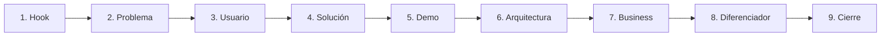
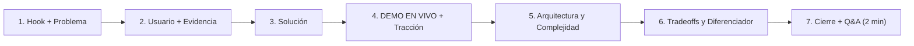

# Guía y Estructura de Pitch (3 Min + 2 Min Q&A) — Hack the Andes

Este documento integra la estructura base del pitch, los tips de grabación (audios) y las reglas oficiales de evaluación y entrega de **Hack the Andes**:
- [Condiciones de entrega y presentación](../condiciones_entrega.md)
- [Guía para equipos](../guia_equipos.md)
- [Cómo se evalúa a los equipos](../como_se_evalua_a_los_equipos.md)

---

## 0. Requisitos Eliminatorios y Reglas de Escenario (Paso 0)

> [!CAUTION]
> **Hora límite de entrega: Domingo 18 de octubre, 09:00 AM.**  
> Cuando la organización abre la evaluación, se guarda una **copia congelada** de la entrega (`--deployment-url`, `--presentation-url`, `--github-url`, `--description`) y de la bitácora (`andes project updates`). Los cambios posteriores a esa hora **no actualizan** la copia que recibe el jurado.

1. **URL pública funcionando (`--deployment-url`):** Desplegada en internet (`localhost` **no** cuenta).
2. **Demo EN VIVO obligatoria:** La demostración principal **debe correr en vivo desde la URL pública**. Presentar únicamente slides o un video grabado **no cuenta** para aprobar el Paso 0 ni el criterio *Funciona (25%)*.
3. **Repositorio en GitHub (`--github-url`):** Código limpio, con manejo de errores y **cero secretos/tokens** en el historial (se evalúa con 20% del puntaje).
4. **Presentación por enlace (`--presentation-url`) sin tu laptop:** No podrás conectar tu laptop al proyector. La organización abrirá tus enlaces desde su propia computadora **sin tu sesión iniciada**. Todo debe abrir en ventana privada/incógnito sin pedir permisos ni depender de archivos locales.
5. **Autoría y honestidad técnica:** Debes distinguir explícitamente **qué funciona hoy en vivo** de **qué limitaciones o ideas quedan pendientes**.

---

## 1. Estructura Visual del Pitch y Adaptación a la Rúbrica


### A. Flujo original (MVP para Startup)


### B. Flujo optimizado para Hack the Andes (Sin *Business* + *Evidencia/Tracción* y *Tradeoffs*)
> **Nota clave (Audio 1 + Rúbrica Oficial):** En hackatón se quita el bloque de *Business*. Además, según [cómo se evalúa a los equipos](../como_se_evalua_a_los_equipos.md), el **75% del puntaje es Técnico** (Complejidad 30%, Funciona en vivo 25%, Calidad de código 20%), el **25% es Producto** (Problema/Usuario 15%, Claridad/Tradeoffs 10%) y hay un **Bonus de +0,5 pts por Tracción real mostrada desde el producto**.



---

## 2. Cómo Integrar el Tip de Video Móvil (Audio 2) sin Romper la Regla de "Demo en Vivo"

> **Resumen del tip (Audio 2):**
> Usar una extensión de navegador que cambie la vista a **modalidad celular con marco/interfaz de teléfono** ([*Mobile Simulator - responsive testing tool*](https://chromewebstore.google.com/detail/mobile-simulator-responsi/ckejmhbmlajgoklhgbapkiccekfoccmk)) y grabarlo con **OBS Studio**. En las slides de explicación de módulos, colocar a la izquierda las funciones y a la derecha el video del módulo en celular o desktop.

> [!IMPORTANT]
> **Regla de Oro en Hack the Andes:**  
> Como la rúbrica exige **Demo en vivo desde la URL pública (25% de la nota y requisito eliminatorio)** y otorga el puntaje máximo (5 pts) cuando **"corre con datos reales y aguanta preguntas fuera del guion"**, **NO reemplaces la demo en vivo por un video**. Usa una estrategia híbrida:

1. **Durante el bloque central de Demo (65–75 segundos):**
   - Cambia a la pestaña de la **URL pública desplegada (`--deployment-url`)** en la computadora del escenario y ejecuta el recorrido principal **en vivo con datos reales** (ej. datos oficiales de SIAGIE/ESCALE y registros reales).
   - Muestra **desde dentro del producto en vivo** la evidencia de **Tracción (+0,5 pts bonus)**: registros reales de docentes/usuarios externos que probaron la herramienta durante el hackathon (recuerda que capturas de pantalla sueltas o cuentas del propio equipo no cuentan).
2. **Dónde usar el video grabado con OBS + Marco de Celular (Audio 2):**
   - **En la slide de Solución o vistas secundarias (Layout dividido Izquierda/Derecha):** Mientras explicas en 15 segundos la propuesta o un flujo secundario (ej. cómo se ve la alerta en el celular de un docente/padre sin tener que redimensionar el navegador en vivo), pon el texto a la izquierda y el **video con marco de celular en autoplay/loop a la derecha**.
   - **En las slides de respaldo (Plan B y revisión asíncrona):** Si el jurado revisa la URL de tu presentación cuando evalúa o en la galería pública, esos videos embebidos permiten ver cada módulo funcionando al instante.

---

## 3. Cómo Maximizar cada Punto de la Rúbrica en 3 Minutos

La nota máxima es **5,5 puntos** ($\text{Técnico } 3,75 + \text{Producto } 1,25 + \text{Bonus Tracción } 0,50$). En caso de empate, **gana 1.º mayor Complejidad Técnica y 2.º mayor puntaje en Funciona**.

| Criterio | Peso / Pts | Qué exige el jurado para dar 5/5 | Cómo demostrarlo en el Pitch |
| :--- | :---: | :--- | :--- |
| **1. Complejidad Técnica** *(Desempate #1)* | **30%** *(1,50 pts)* | Datos reales, modelos o servicios orquestados, arquitectura no trivial (no un simple CRUD o wrapper de API). | En la slide de **Arquitectura**, muestra el pipeline real: ingesta de datos oficiales (MINEDU/ESCALE/SIAGIE), motor de inferencia/reglas/IA y orquestación. |
| **2. Funciona** *(Desempate #2)* | **25%** *(1,25 pts)* | Corre en vivo desde la URL pública con datos reales y **aguanta preguntas fuera del guion**. | Haz la **Demo en vivo** en el navegador sobre la URL pública. Deja lista la app para que en los 2 min de Q&A puedas hacer clic donde pida el jurado. |
| **3. Calidad Técnica** | **20%** *(1,00 pt)* | Código en GitHub sólido, maneja errores, casos borde y **cero credenciales/secretos** expuestos. | Menciona 1 decisión de robustez (validación, manejo de fallos, variables de entorno limpias) y ten el repo impecable antes de las 09:00 AM. |
| **4. Problema e Impacto** | **15%** *(0,75 pts)* | Usuario específico del track Educación Escolar y evidencia concreta del problema. | En **Hook + Problema + Usuario**, nombra al usuario exacto (ej. director/docente/psicólogo de colegio público) respaldado por cifras reales y entrevistas. |
| **5. Claridad y Tradeoffs** | **10%** *(0,50 pts)* | Queda claro qué hicieron, **por qué lo hicieron y qué quedó fuera**. | Dedica 15 segundos a decir explícitamente: *"Priorizamos X por impacto; dejamos fuera Y como limitación actual"*. |
| **Bonus: Tracción** | **+0,50 pts extra** | Personas fuera del equipo lo usaron durante el hackathon y **se ve desde el producto**. | En la Demo en vivo, abre la vista de actividad/registros reales o lista de espera dentro de la app para probar uso externo real. |

---

## 4. Cronograma Exacto: 3 Minutos de Pitch + 2 Minutos de Preguntas

Un pitch de 3 minutos equivale a **~390–410 palabras**. No pases de 6 a 7 diapositivas en total.

| Tiempo | Bloque | Qué decir y mostrar | Criterio que ataca |
| :---: | :--- | :--- | :--- |
| **`0:00 - 0:25`** *(25 s)* | **1. Hook + Problema + Usuario** | Cifra real contundente del problema en Educación Escolar + quién es el usuario específico y cómo sufre el problema hoy (más 1 hallazgo de validación con usuarios reales). | Problema e Impacto (15%) |
| **`0:25 - 0:40`** *(15 s)* | **2. Solución (Vista General)** | En 1 frase qué construimos. *(Aquí puedes poner a la derecha el video corto de OBS en marco móvil mostrando la interfaz móvil mientras pasas al navegador en vivo)*. | Claridad (10%) |
| **`0:40 - 1:55`** *(75 s)* | **3. DEMO EN VIVO + Tracción** | **En la URL pública desplegada:** ejecuta el flujo principal con datos reales. Muestra el resultado clave y abre en vivo la sección del producto que evidencia uso/registros de usuarios reales fuera del equipo. | Funciona (25%) + Bonus Tracción (+0,5) |
| **`1:55 - 2:25`** *(30 s)* | **4. Arquitectura y Complejidad** | Vuelve a la slide de arquitectura: explica por qué no es un wrapper simple (orquestación de servicios, modelos, cruce de datasets reales, manejo de casos borde). | Complejidad (30%) + Calidad (20%) |
| **`2:25 - 2:45`** *(20 s)* | **5. Tradeoffs, Diferenciador y Limitaciones** | Explica **por qué** tomaste esa decisión técnica, qué te diferencia de lo actual y **qué dejaste fuera conscientemente** (honestidad técnica exigida por la guía). | Claridad / Tradeoffs (10%) |
| **`2:45 - 3:00`** *(15 s)* | **6. Cierre** | Conecta con el Hook inicial, resume el impacto y deja la aplicación abierta en pantalla lista para preguntas. | Pitch / Cierre |
| **`+2:00 min`** | **7. Preguntas del Jurado (Q&A)** | Responde con precisión mostrando la app en vivo ("aguanta preguntas fuera del guion") o tus slides de Apéndice. | Funciona (5/5) + Esfuerzo Técnico |

---

## 5. Herramientas y Agent Skills para Armar la Presentación y el Demo

### A. Skills disponibles en este repositorio (`.agents/skills/`)
1. **`chofex-hackathon` ([SKILL.md](../../.agents/skills/chofex-hackathon/SKILL.md)):**
   - Permite publicar avances en la bitácora (`andes project update`) y enviar/actualizar los 4 entregables oficiales (`andes project submit`) verificando el estado en JSON.
2. **`remotion` ([SKILL.md](../../.agents/skills/remotion/SKILL.md)):**
   - Para generar clips MP4 animados a partir de pantallas de Stitch con zoom y callouts si deseas incrustar una vista móvil de apoyo en tus slides.
3. **`taste-design` y `design-md`:**
   - Para mantener consistencia visual entre la app web y las diapositivas.

### B. Agent Skills externos instalables (`npx skills add`)
Si prefieres crear una **presentación hecha con código** (explícitamente permitida en [condiciones_entrega.md](../condiciones_entrega.md#L21)):
- **Slidev (Markdown + Vue + Deploy en Vercel):**
  ```bash
  npx skills add slidevjs/slidev --skill slidev
  ```
  *Ventaja para Hack the Andes:* Puedes embeber un layout mitad explicación / mitad video móvil o incluso un `<iframe>` directo a tu `--deployment-url` para no perder segundos cambiando de ventana en la PC de la organización.
- **Frontend HTML Slides:**
  ```bash
  npx skills add https://github.com/zarazhangrui/frontend-slides --skill frontend-slides
  ```
- **Marp Slides:**
  ```bash
  npx skills add robonuggets/marp-slides --skill marp-slides
  ```

### C. Herramientas en la nube y de captura
- **Presentaciones por URL pública instantánea:** **Pitch.com**, **Canva**, **Google Slides** o **Figma Slides** (recuerda activar *"Cualquier persona con el enlace puede ver"*).
- **Simulador Móvil + Grabación (Audio 2):** Extensión de Chrome **Mobile Simulator - responsive testing tool** + **OBS Studio** (para los clips de apoyo en las slides).

---

## 6. Checklist y Método de Preparación antes de las 09:00 AM del Domingo

1. **Entrega temprana y bitácora activa (`andes project update`):**
   - No esperes al domingo a las 08:55 AM. Sube los 4 entregables temprano con `andes project submit` y actualízalos conforme avances.
   - Publica en la bitácora (`andes project update`) cada hito real: validación con docentes/usuarios, decisiones de arquitectura y despliegue en vivo. El jurado recibe copia de la bitácora al cerrarse la entrega.
2. **Prueba del "Modo Incógnito en PC Ajena":**
   - Abre una ventana de incógnito (sin cuentas logueadas) y prueba:
     - ¿Abre `--presentation-url` sin pedir login?
     - ¿Abre `--deployment-url` rápido y tiene un botón de **"Probar Demo / Ingreso Rápido"** con datos reales precargados para no perder 20 segundos tipeando usuario y contraseña en el escenario?
3. **Auditoría de GitHub (Para asegurar el 20% de Calidad Técnica):**
   - Verifica que no exista ningún `.env`, API key o token hardcodeado en los commits.
   - Incluye un `README.md` claro y un archivo de descripción en Markdown que explique: **problema, para quién es, cómo funciona y qué limitaciones tiene**.
4. **Entrenamiento para "Preguntas Fuera del Guion" (2 minutos de Q&A):**
   - Para obtener **5/5 en Funciona (25%)**, el jurado probará o pedirá ver casos fuera de tu camino feliz (*happy path*).
   - Practica con tu equipo 5 preguntas difíciles y ten 2 slides de *Apéndice* al final del deck (diagrama de base de datos/privacidad y métricas de validación con usuarios reales).
