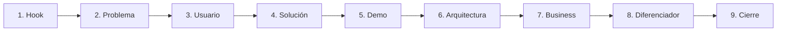
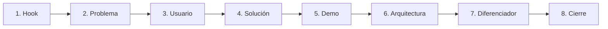

# Guía y Estructura de Pitch (3 Minutos) — Hack the Andes

Este documento resume la estructura de pitch, los tips de grabación de demo y la metodología de preparación para presentar en un máximo de **3 minutos (180 segundos)**.

---

## 1. Estructura Visual del Pitch


### A. Flujo completo (MVP para Startup)
Cuando el pitch está orientado a levantar capital o presentar un MVP de startup completo, sigue estos **9 bloques**:



### B. Flujo adaptado para Hackatón (Sin *Business*)
> **Nota clave (Audio 1):** *"Esto es con MVP para una startup. Si en caso es solo para hackatón, quitas el Business."*

En una hackatón de 3 minutos el jurado evalúa **impacto del problema, ejecución técnica, demo funcional y diferenciación**, por lo que se elimina el bloque de *Business* para darle más aire al **Demo**:



---

## 2. Tip de Grabación y Layout para el Demo (Audio 2)

> **Resumen del tip (Audio 2):**
> Usar una extensión de navegador que cambie la vista a **modalidad celular con marco/interfaz de teléfono real** y grabarlo con **OBS Studio** (o grabador integrado). Al presentar cada módulo en las diapositivas, usar una estructura dividida:
> - **Lado izquierdo / voz:** Explicas el módulo y sus funciones clave (*"Acá está el módulo de clientes..."*).
> - **Lado derecho:** Aparece reproduciéndose automáticamente el video del módulo en interfaz de celular o desktop mientras hablas.

### Flujo de trabajo para lograr ese efecto:
1. **Instalar extensión de marco móvil en Chrome/Brave:**
   - [**Mobile Simulator - responsive testing tool**](https://chromewebstore.google.com/detail/mobile-simulator-responsi/ckejmhbmlajgoklhgbapkiccekfoccmk) (Mobile FIRST): Envuelve tu `localhost` o URL desplegada dentro del marco real de un iPhone o Android y permite ocultar la barra del navegador o poner fondo transparente/oscuro.
2. **Grabar con OBS Studio (o exportación directa WebM/MP4):**
   - Captura únicamente la ventana o región del dispositivo móvil (o haz una escena combinada Desktop + Mobile en OBS).
   - Graba flujos cortos de **10 a 20 segundos por módulo** (sin tiempos muertos ni pantallas de carga).
3. **Montaje en la Slide (Layout 40% / 60%):**
   - **Izquierda (40%):** Título del módulo + 2 o 3 bullets ultra cortos de valor.
   - **Derecha (60%):** Video en *autoplay + loop + sin sonido* mostrando exactamente los clics que estás narrando.

---

## 3. Distribución de Tiempo (180 Segundos Exactos — Modo Hackatón)

Un discurso de 3 minutos a ritmo claro (135 palabras por minuto) equivale a **~400 palabras en total**.

| Bloque | Tiempo | Duración | Objetivo y qué mostrar |
| :--- | :---: | :---: | :--- |
| **1. Hook** | `0:00 - 0:15` | **15 s** | Dato duro impactante (ej. MINEDU/SIAGIE) o historia real de 1 línea. **Prohibido** empezar con *"Hola, somos el equipo X"*. |
| **2. Problema** | `0:15 - 0:35` | **20 s** | Qué dolor existe hoy, cuánto cuesta o a cuántos estudiantes/colegios afecta y por qué falla el proceso actual. |
| **3. Usuario** | `0:35 - 0:50` | **15 s** | Quién sufre el problema directamente (director, docente, psicólogo escolar, padre) y cómo es su día a día hoy. |
| **4. Solución** | `0:50 - 1:05` | **15 s** | En **una sola frase**: qué construimos y cómo transforma el problema del usuario. |
| **5. Demo** | `1:05 - 2:10` | **65 s** | **El corazón del pitch.** Mostrar 2–3 módulos clave con el layout dividido (explicación + video en marco móvil/desktop a la derecha). |
| **6. Arquitectura** | `2:10 - 2:30` | **20 s** | Diagrama limpio del stack, flujo de datos, IA/modelos o integraciones que hacen que la solución funcione de verdad. |
| **7. Diferenciador** | `2:30 - 2:45` | **15 s** | Por qué nuestra solución es única frente a lo que existe hoy (velocidad, enfoque preventivo, datos locales, UX accesible). |
| **8. Cierre** | `2:45 - 3:00` | **15 s** | Impacto esperado, visión a futuro y frase final memorable conectada con el *Hook* inicial. |

---

## 4. Regla Crítica de Hack the Andes para la Presentación

Según los lineamientos oficiales del evento (`chofex-hackathon`):
- **No se conecta la laptop del equipo al proyector.** La organización abre tu enlace de presentación (`--presentation-url`) y tu app (`--deployment-url`) desde la computadora del escenario.
- **Todo debe funcionar en una ventana de incógnito sin iniciar sesión:**
  - Si usas Canva, Google Slides, Pitch, Gamma o una web propia (Slidev/Vercel), verifica que el link sea **100% público**.
  - Los videos del demo dentro de la presentación deben estar **subidos/alojados en la presentación**, nunca enlazados a archivos locales de tu PC.

---

## 5. Herramientas y Agent Skills para Crear el Deck

### A. Skills ya incluidos en este repositorio (`.agents/skills/`)
1. **`remotion` (`.agents/skills/remotion/SKILL.md`):**
   - Convierte pantallas de Stitch o capturas de la app en un **video programático en React (MP4)** con zoom suave (`spring()`), transiciones (`@remotion/transitions`) y textos destacados (*hotspots*).
2. **`taste-design` y `design-md`:**
   - Permiten extraer o definir la paleta, tipografía y tokens visuales para que las diapositivas tengan exactamente el mismo diseño premium que el producto.

### B. Agent Skills externos instalables (`npx skills add`)
Si quieres que el agente genere las diapositivas directamente desde código o Markdown:
- **Slidev (Recomendado para devs + deploy en Vercel):**
  ```bash
  npx skills add slidevjs/slidev --skill slidev
  ```
  *Ventaja:* Creas las slides en Markdown + Vue/Tailwind, embebes tus videos MP4 de OBS a la derecha con un grid simple y lo despliegas en Vercel para tener tu `--presentation-url` lista y ultra rápida.
- **Frontend HTML Slides (Presentaciones web de alto impacto):**
  ```bash
  npx skills add https://github.com/zarazhangrui/frontend-slides --skill frontend-slides
  ```
- **Marp Slides (Markdown directo a PDF / PPTX / HTML):**
  ```bash
  npx skills add robonuggets/marp-slides --skill marp-slides
  ```

### C. Herramientas visuales de diseño y grabación rápida
- **Para armar el Deck rápido en la nube:**
  - **Pitch.com** o **Canva:** Excelentes para arrastrar videos MP4 dentro de mockups de celular o layouts mitad-texto / mitad-video y compartir con link público.
  - **Figma Slides:** Ideal si ya tienes componentes diseñados; permite prototipos y videos lado a lado.
  - **Gamma.app:** Muy veloz para estructurar tarjetas si tienes poco tiempo, aunque Pitch/Canva/Slidev dan más control sobre el tamaño del video del demo.
- **Para grabar el Demo con acabado profesional:**
  - **Mobile Simulator (Chrome Extension) + OBS Studio:** El combo del Audio 2 (marco de celular real + grabación limpia).
  - **Screen Studio** (macOS) / **Cursorful** (Chrome Extension gratuita) / **Cap.so**: Añaden zoom automático suave hacia donde haces clic, haciendo que la interfaz se vea nítida incluso desde el fondo del auditorio.

---

## 6. Métodos para Prepararte y Entrenar el Pitch de 3 Minutos

1. **Método del Guion de 400 Palabras (Word Budgeting):**
   - Escribe el guion completo palabra por palabra. Si supera las 420 palabras, recorta frases antes de ensayar: físicamente no entra en 3 minutos sin hablar acelerado.
2. **La Regla del "Hook Espejo" (Circular Storytelling):**
   - Empieza el **Hook** con una persona o cifra concreta (ej. *"Cada día en el Perú, X estudiantes abandonan el colegio sin que nadie detecte las señales a tiempo"*) y cierra en el **minuto 2:50** volviendo a esa misma idea (*"Con [Nombre], ninguna señal vuelve a pasar desapercibida"*).
3. **Ensayo con "Semáforo de Tiempo" (Checkpoints):**
   - Pon un cronómetro visible al ensayar y verifica dos marcas obligatorias:
     - **Minuto `1:00`:** Ya debes estar entrando al **Demo**. Si al minuto `1:15` sigues explicando el problema, recorta la introducción a la mitad.
     - **Minuto `2:10`:** El Demo debe haber terminado para pasar a Arquitectura, Diferenciador y Cierre sin que te corten el micrófono.
4. **Ensayo de Transición de Voces (Si habla más de 1 persona):**
   - En un pitch de 3 minutos, lo ideal es **1 solo orador** (o máximo **2 personas**: una para Hook/Problema/Cierre y otra para Demo/Arquitectura). Cada cambio de micrófono cuesta 4–5 segundos valiosos.
5. **Matriz de Q&A (Post-Pitch):**
   - Ten 2 o 3 slides ocultas al final (*Appendix*) listas para las preguntas del jurado:
     - Privacidad de datos de menores / escolares.
     - Cómo se integra con SIAGIE o el flujo actual de los colegios sin dar más carga laboral al docente.
     - Costo de infraestructura / escalabilidad real.
