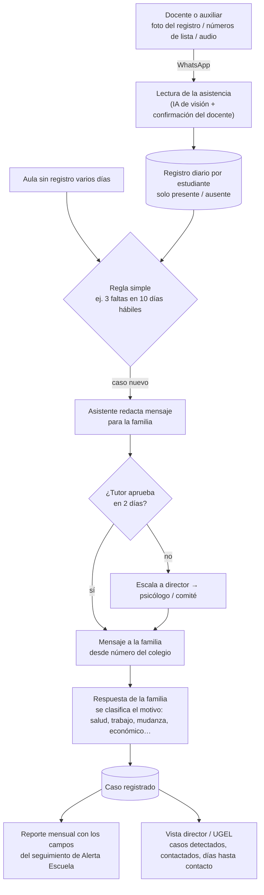

# Soluciones y preguntas clave — Deserción escolar (Hack the Andes, track Educación)

Documento vivo del equipo **Futuro Agéntico**. Responde las 5 preguntas del reto con la evidencia que hay en el repo y propone la solución a demostrar.

**Cómo leer las etiquetas:**

- **[Dato]** cifra oficial con fuente en `docs/`.
- **[Entrevista]** lo dijo la docente entrevistada (`notas_sesión_1.md`). Es **una sola persona**: sirve como señal, no como prueba.
- **[Doc]** viene de la documentación de Alerta Escuela (`docs/alerta_escuela_documentacion.md`). Es una recopilación hecha por el equipo y no siempre cita la norma exacta.
- **[Supuesto]** idea del equipo que todavía nadie ha confirmado.
- **[Validar]** hay que comprobarlo antes del pitch.

---

## Resumen en 30 segundos

Cuando un estudiante empieza a faltar, **nadie actúa a tiempo**. El tutor o el auxiliar anota la falta, el reporte sube cada bimestre, el director lo ve en Alerta Escuela semanas después y, según la docente entrevistada, "no hacen nada si un estudiante se ausenta".

**Propuesta:** un asistente por WhatsApp para el **tutor (primaria) o el auxiliar (secundaria)**. **No le pide digitar nada nuevo:** basta una foto del registro de asistencia que ya llena. Detecta el patrón de faltas, prepara el mensaje a la familia, registra la respuesta y genera solo el reporte de seguimiento que hoy se llena a mano. Si el docente no actúa, el caso escala a otra persona. La UGEL ve, por colegio, cuántos casos fueron contactados y en cuántos días.

**Dónde probar:** Ucayali (Coronel Portillo). Tiene la tasa de secundaria más alta del país (5,11 %) y varios distritos críticos en una misma provincia. [Dato]

---

## 1. ¿Quién tiene el problema y cómo lo resuelve hoy?

### Quién

Son tres actores distintos. Conviene no mezclarlos en el pitch:

| Rol | Por qué le importa | Qué hace hoy | Evidencia |
|---|---|---|---|
| **Tutor de aula (primaria) / auxiliar (secundaria)** — *quien usa la solución* | Es quien ve primero que el estudiante falta y quien conoce a la familia. | Registra asistencia y tardanzas y entrega un reporte **por bimestre**. | [Entrevista] |
| **Director** — *quien responde por el colegio* | Es el único con acceso a Alerta Escuela y debe reportar a la UGEL. | Revisa el listado de riesgo, lo reparte a los tutores y llena el seguimiento mensual. | [Entrevista] acceso solo del director · [Doc] flujo y formulario mensual |
| **UGEL / DRE** — *quien podría pagar* | Tiene metas de permanencia y de uso de Alerta Escuela atadas a incentivos económicos (Compromisos de Desempeño). | Recibe reportes de los colegios y les da asistencia técnica. | [Doc] · [Validar] indicadores vigentes en 2026 |

El **estudiante y su familia** son quienes sufren el problema, pero no son los usuarios de la herramienta.

> **Cambio respecto a lo que definimos en la sesión 1:** las notas ponen al *gobierno central* como usuario primario porque "nos paga". Proponemos separar **quién paga** (UGEL/DRE, o el Minedu a escala) de **quién usa** (tutor o auxiliar). Un tablero para el Minedu no cambia lo que pasa en el aula, y el jurado va a preguntar quién hace la acción. [Supuesto — decisión del equipo]

### Cómo lo resuelve hoy

1. El tutor o el auxiliar registra las faltas. El reporte sube **por bimestre**. [Entrevista]
2. Alerta Escuela calcula el riesgo con un modelo predictivo usando SIAGIE, RENIEC y SISFOH, y muestra un semáforo **solo al director**. [Doc] [Entrevista]
3. El director descarga el listado y debe registrar cada mes si hubo contacto con la familia. [Doc]
4. El contacto con la familia depende de que el docente llame desde **su teléfono personal**. [Doc]
5. Si el caso es grave, se deriva al psicólogo. Pero el psicólogo solo conserva su plaza si registra un mínimo de atenciones al año ("creo que mínimo 150"). Si no reporta, "el Minedu lo toma como que no es necesario tener psicólogo allí". [Entrevista] [Validar la cifra de 150]

**Dónde se rompe:**

- **Llega tarde.** La alerta sale de datos bimestrales; cuando marca rojo, el estudiante puede llevar semanas sin ir. [Doc]
- **Nadie es dueño de la acción.** Saber el riesgo no dice qué hacer ni quién lo hace. "No sirve, porque no hacen nada si un estudiante se ausenta." [Entrevista]
- **El registro es carga, no ayuda.** Los formularios mensuales se llenan para cumplir con la UGEL. [Doc] Y si no se llenan, el colegio puede perder recursos: el caso del psicólogo. [Entrevista]

---

## 2. ¿Cuál es la acción más importante que debe poder completar esa persona?

> **Que el tutor o el auxiliar contacte a la familia del estudiante que empezó a faltar dentro de la misma semana, y que ese contacto quede registrado sin trabajo extra.**

Por qué esta acción y no otra:

- Ataca la falla que se repite en todas las fuentes: el paso de la alerta a la acción. [Doc] [Entrevista]
- Es **medible**: días desde la primera falta del patrón hasta el contacto con la familia. Hoy, con reportes bimestrales, pueden ser semanas. [Supuesto — medir la línea base]
- El registro que sale de esta acción es justo lo que el director y la UGEL necesitan para el seguimiento de Alerta Escuela. Un solo gesto del tutor alimenta a los tres actores.

**Criterio para la demo:** en menos de 2 minutos, el tutor recibe el aviso, aprueba o edita el mensaje para la familia, lo envía y el caso queda registrado como *contactado*. [Supuesto — meta de diseño]

---

## 3. ¿Qué evidencia tenemos de que la solución le ayuda?

**Lo honesto: todavía muy poca evidencia directa.** Tenemos evidencia fuerte de que **el problema existe** y evidencia débil de que **esta solución** ayuda.

### Evidencia del problema (fuerte)

- **Deserción de secundaria 2023→2024: 2,54 %**, que son 72 282 estudiantes. Primaria: 1,73 % (64 463). [Dato — SIAGIE, `desercion_por_region_siagie_2023_2024.md`]
- **Se concentra en la Amazonía y la costa norte:** Ucayali 5,11 %; distritos como Masisea (11,1 %) y Manantay (8,4 %) en Coronel Portillo. [Dato]
- **La brecha rural crece:** 3,7 % rural frente a 2,4 % urbano en 2024-2025. [Dato — ESCALE Cuadro 321]
- **Aprobar no es aprender:** en 2.° de secundaria aprueba el 93,9 %, pero solo el 18,5 % logra lectura satisfactoria y el 12,7 % matemática (2025). En Ucayali, 7,1 % y 3,4 %. [Dato — UMC/ESCALE]
- **Las faltas son una señal temprana reconocida:** Alerta Escuela usa el ausentismo como una de sus variables de mayor peso. [Doc]

### Evidencia de que esta solución ayuda (débil, por construir)

- **Una docente** confirma que el sistema actual no lleva a la acción. Es necesidad, no validación de nuestra solución. [Entrevista]
- **Evidencia externa a revisar:** hay estudios conocidos sobre mensajes a padres y ausentismo (Rogers & Feller, 2018, *Nature Human Behaviour*; Bergman & Chan, 2021, *Journal of Human Resources*). Se hicieron en EE. UU. y **nadie del equipo los ha leído todavía**. [Validar — leer y citar con cifras exactas, o no usarlos]
- **No tenemos** ninguna prueba con un tutor real usando un prototipo.

### Cómo conseguir evidencia antes del pitch

| Prueba | Con quién | Qué medimos | Éxito si… |
|---|---|---|---|
| Mostrar el flujo en WhatsApp (maqueta clicable o capturas) | 3 tutores o auxiliares, idealmente uno de Ucayali | ¿Lo usarían esta semana? ¿Qué cambiarían? | 2 de 3 dicen que lo usarían sin que se lo pidan |
| Preguntar la línea base | Los mismos + 1 director | ¿Cuántos días pasan hoy entre que un alumno empieza a faltar y alguien llama a la familia? | Tenemos un número real, aunque sea aproximado |
| Validar quién paga | 1 especialista de UGEL o DRE | ¿Los Compromisos de Desempeño 2026 premian la permanencia o el uso de Alerta Escuela? ¿Hay presupuesto para herramientas? | Confirma el incentivo, o lo descartamos del pitch |

---

## 4. ¿Qué nos bloquea ahora y qué ayuda concreta necesitamos?

| Bloqueo | Por qué importa | Ayuda concreta que pedimos |
|---|---|---|
| **Una sola entrevista** | No podemos decir que los docentes quieren esto. | **Mentores:** contacto de 2-3 tutores o auxiliares y 1 director, idealmente de Ucayali. Media hora por videollamada. |
| **No hay acceso a datos nominales** (SIAGIE y Alerta Escuela solo los ve el director) | No podemos usar datos reales de estudiantes, ni deberíamos. | Usar **datos sintéticos** con la forma real. **Pedido:** que un director nos muestre (sin datos personales) cómo se ve el listado de Alerta Escuela y el formulario mensual. |
| **No sabemos si la UGEL paga** | Sin comprador, la propuesta es solo un proyecto. | **Mentores o contactos de gobierno:** confirmar los indicadores vigentes de los Compromisos de Desempeño. |
| **WhatsApp Business API** pide verificación de Meta y plantillas aprobadas | No llegamos a enviar mensajes reales a familias en el hackathon. | Demo con **número de prueba o simulado**. Decidir en el equipo si basta. |
| **Leer registros escritos a mano** | Si la IA lee mal la foto, marca faltas falsas y el docente deja de confiar. | Que el docente confirme lo leído con un toque ("¿faltaron 4, 12 y 18?"). **Pedido:** 3-5 fotos reales de registros de asistencia, sin nombres o tapados, para probar la lectura antes de la demo. |
| **No sabemos cómo se toma hoy la asistencia** | Si es en SIAGIE directo y no en papel, la captura por foto no aplica y hay que rediseñarla. | **Equipo:** preguntarlo en las próximas entrevistas (prioridad 1). |
| **Cifras inconsistentes en el repo** | El jurado puede pillar un dato contradictorio. | Interno: (a) el README usa ESCALE 2024-2025 (Ucayali 4,9 %) y el análisis SIAGIE usa 2023-2024 (Ucayali 5,11 %); son periodos distintos y hay que rotularlos. (b) Huánuco salta de 1,3 % a 5,0 % entre 2023-24 y 2024-25 en el CSV de ESCALE; verificarlo en la fuente antes de citarlo. (c) "2,8 % en 2026" es una **estimación nuestra**, no un dato del Minedu. |
| **Migración en frontera** | Parte de la "deserción" en Aguas Verdes, Callao o Lima puede ser gente que se fue del país. | Usar Ucayali como ejemplo principal (menos expuesto a esto) y decirlo como limitación. |
| **Decisión de usuario sin cerrar** | Gobierno o docente: el pitch cambia según la respuesta. | **Equipo:** confirmar la propuesta de la sección 1. |

---

## 5. ¿Qué podemos dejar fuera para demostrar una solución que funcione?

**Dentro de la demo (mínimo que prueba la idea):**

1. El tutor registra la asistencia del día por WhatsApp, con un mensaje o una foto de la lista. Datos sintéticos de un aula en Coronel Portillo.
2. El asistente detecta un patrón simple y explicable, por ejemplo **3 faltas en 10 días hábiles**. [Supuesto — umbral a validar con docentes]
3. Propone un mensaje empático para la familia. El tutor lo aprueba o lo edita.
4. Registra el resultado: contactado, sin respuesta o derivado.
5. Genera el resumen de seguimiento del mes con los campos del formulario de Alerta Escuela, listo para el director.
6. Una vista simple para director o UGEL: casos detectados, contactados y días hasta el contacto.
7. Dos escenas que responden la objeción "el docente no llena datos": un **aula en silencio** (no mandó asistencia en 3 días y el director recibe el aviso) y un **caso que escala** (el tutor no aprobó en 2 días y pasa al director).

**Fuera (y por qué):**

| Lo dejamos fuera | Razón |
|---|---|
| **Modelo predictivo propio** | El Minedu ya tiene uno. Nuestro valor está en la acción, no en predecir mejor. Una regla simple se explica mejor al jurado. |
| **Integración real con SIAGIE o Alerta Escuela** | No hay API pública ni acceso. Se muestra como "exportable con el mismo formato". |
| **Mensajes reales a familias** | Requiere verificación de Meta, consentimiento y protección de datos de menores. Se simula. |
| **Planes de nivelación o contenido pedagógico con IA** | El problema de aprendizaje es real, pero es otro producto. Diluye la demo. |
| **Módulo para el psicólogo** | Es una buena segunda fase: el registro automático protegería la plaza. Hoy solo tenemos una cita sin confirmar. |
| **App para padres, varias regiones, tablero nacional** | Más alcance sin más evidencia. |

---

## Cómo funciona a nivel de sistema (aunque el docente no llene datos)

**La objeción más fuerte:** en el Perú muchos docentes no llenan los registros. Están sobrecargados, a veces trabajan en más de un colegio, pagan los datos móviles de su bolsillo, y el registro sube a la UGEL sin que nada vuelva al aula. Además, reportar a un alumno que deserta puede verse mal para el colegio, y eso empuja a los "reportes ficticios". [Doc] [Entrevista: "no hacen nada si un estudiante se ausenta"] Si la solución depende de que el docente digite más, fracasa igual que lo actual.

### Principios de diseño

1. **Reemplazar trabajo, no añadirlo.** Lo que sale del sistema (el reporte mensual de seguimiento y el bimestral de asistencia) es algo que el docente o el director **ya tienen que entregar**. Si usarlo cuesta menos que hacerlo a mano, hay razón para usarlo. Si no, no. [Supuesto — validar cuánto tiempo toman hoy esos reportes]
2. **Capturar lo que ya existe, con el mínimo esfuerzo.** La asistencia ya se toma: la toma el docente en primaria y el auxiliar en secundaria. [Entrevista] No pedimos digitar: el docente manda **una foto del registro de asistencia** (papel o cuaderno) y el sistema la lee. Alternativas: responder con los números de lista de los ausentes, o un audio. [Validar — cómo se toma hoy la asistencia: papel, Excel o SIAGIE]
3. **Que el silencio también sea una señal.** Si un aula deja de mandar asistencia varios días, eso alerta al director. No depender de un solo actor significa detectar cuándo ese actor falla.
4. **Devolver algo al docente en el momento.** Por cada registro recibe algo útil: el mensaje para la familia ya redactado, el reporte del mes listo y la constancia de que hizo su parte (le sirve si después le piden cuentas).
5. **No castigar al que reporta.** A la UGEL no se le muestra "cuántos desertaron en tu aula", sino **cuántos casos se detectaron y en cuántos días se contactó a la familia**. Así reportar no perjudica a nadie, y no da ganas de esconder casos. [Supuesto — validar con UGEL que esa métrica le sirve]
6. **Pruebas difíciles de inventar.** El contacto cuenta como hecho cuando **la familia responde** al mensaje, no cuando alguien marca una casilla. Eso reduce los "reportes ficticios".
7. **Escalar si nadie actúa.** Si el tutor no aprueba el contacto en 2 días hábiles, el caso pasa al director; si sigue sin respuesta, al psicólogo o al comité de bienestar. El estudiante no se pierde porque una persona no pudo. [Supuesto — plazos a validar]
8. **Pensado para la Amazonía.** WhatsApp guarda los mensajes y los envía cuando vuelve la señal; una foto pesa poco. Para familias sin WhatsApp: SMS o llamada. Los mensajes salen de un **número del colegio**, no del celular personal del docente; eso protege su privacidad y no le cuesta datos. [Validar — conectividad en Masisea y Manantay]

### Flujo del sistema

### Lo que este diseño no resuelve (decirlo en el pitch)

- Si **nadie** en el colegio toma asistencia, no hay señal. El sistema lo hace visible (aula en silencio), pero no lo arregla.
- Si la familia no tiene teléfono o no responde, el caso escala a una persona. La tecnología no reemplaza la visita.
- Las causas de fondo (trabajo infantil, pobreza, migración) siguen ahí. El sistema gana tiempo para intervenir y deriva el caso a la red: DEMUNA, Juntos, etc. [Doc]
- Las fotos de los registros y los teléfonos de las familias son datos personales de menores. Hace falta consentimiento y cumplir la Ley 29733 de protección de datos personales. [Validar requisitos]

---

## Soluciones que consideramos

| Opción | Qué es | Por qué sí | Por qué no (ahora) | Veredicto |
|---|---|---|---|---|
| **A. Asistente de seguimiento para el tutor o auxiliar por WhatsApp** | Detecta faltas, prepara el contacto con la familia y genera el registro | Ataca la brecha entre alerta y acción; usa un canal que el docente ya usa; se puede medir | Falta validar adopción; WhatsApp tiene fricción técnica | **Elegida** |
| B. Tablero de priorización para UGEL/DRE | Junta datos abiertos y riesgo por colegio | Cuadra con quién paga | Repite lo que ya hace Alerta Escuela; no cambia nada en el aula; los datos llegan tarde igual | Solo como vista pequeña dentro de A |
| C. Aviso automático a padres el mismo día de la falta | El sistema escribe directo a la familia | El más simple; hay evidencia externa a revisar | Saca al tutor de la relación; necesita teléfonos y consentimiento | Como función de A, con aprobación del tutor |
| D. Asistente de registro para el psicólogo | Registra atenciones por voz o chat | Protegería la plaza del colegio | Una sola cita sin confirmar; usuario muy específico | Fase 2, validar primero |
| E. Copiloto de nivelación por nivel de logro | Planes y materiales con IA | La brecha de aprendizaje es enorme | Otro problema y otro producto; impacto en deserción difícil de demostrar en un hackathon | Fuera |
| F. Mejor modelo predictivo | Machine learning propio | — | Sin datos nominales; el Minedu ya lo hace | Fuera |

---

## Preguntas abiertas para el equipo

1. ¿Aceptamos separar **quién usa** (tutor o auxiliar) de **quién paga** (UGEL/DRE)?
2. ¿Quién del equipo consigue las 3 entrevistas de validación, y para cuándo?
3. ¿Cómo se toma hoy la asistencia: en papel, en Excel o directo en SIAGIE? ¿Cada día o al final del bimestre? Todo el diseño de captura depende de esto. [Validar — prioridad 1]
4. ¿El canal es WhatsApp, o los auxiliares de secundaria prefieren otra cosa? [Validar]
5. ¿Cuánto tiempo le toma hoy a un director o tutor llenar el seguimiento mensual? Esa es la línea base del "reemplazar trabajo". [Validar]
6. ¿Qué umbral de faltas usa hoy un auxiliar para preocuparse? [Validar]

---

*Última actualización: 2026-10-17 · Fuentes: `README.md`, `notas_sesión_1.md`, `docs/alerta_escuela_documentacion.md`, `docs/reporte_desercion_escale.md`, `docs/tasa_desercion_secundaria_escale.csv`, `docs/desercion_por_region_siagie_2023_2024.md`, `docs/reporte_rendimiento_academico_oficial_peru.md`.*
