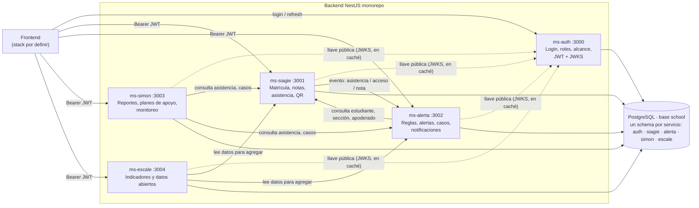

# Diseño del backend — auth + 4 microservicios (NestJS + Prisma + PostgreSQL)

**Estado:** diseño de referencia del backend. Fundación (`ms-auth`/`ms-siagie`) y F2 (`ms-alerta`) implementadas y verificadas sobre schemas de prueba. F3/F4 y las decisiones de dominio de la sección 8 siguen pendientes. Ver [continuidad-backend.md](../../continuidad-backend.md) para estado de migraciones y resultados de pruebas.
**Fecha:** 2026-10-17
**Fuentes:** reunión con la docente Maritta Carrión (17 oct 2026), diagrama y tabla "Lo que hoy existe en MINEDU" del equipo, `docs/soluciones_y_preguntas_clave.md`, `docs/alerta_escuela_documentacion.md`.

---

## 1. Intención

Replicar el ecosistema de sistemas del MINEDU (SIAGIE → Alerta Escuela, SIMON, ESCALE) **cerrando las brechas que tiene hoy**:

| Sistema real | Brecha hoy (tabla del equipo + reunión) | Qué hace nuestra versión |
|---|---|---|
| *(login)* | En la realidad, Alerta Escuela usa el usuario del SIAGIE: el login está pegado a un sistema operativo. | **ms-auth** separado: un solo login con roles y alcance para todo el ecosistema. |
| **SIAGIE** | Operativo, no predictivo. Solo lo usan secretaría y dirección. La asistencia se registra a mano y sube por bimestre. | Fuente única de matrícula, notas y asistencia **diaria y por hora**, más ingreso/salida por QR. |
| **Alerta Escuela** | No agrega a nivel UGEL/DRE, no recomienda intervención, no cierra el ciclo. Se usa para fiscalizar metas de atención y recortar plazas. [Reunión] | Alertas en tiempo real, **casos con responsable, escalamiento y contacto con la familia**, y avisos de ingreso y salida a los padres y al auxiliar. |
| **SIMON** | Burocrático y poco amigable. | Reportes que se **generan solos** a partir de lo registrado, **planes de apoyo personalizados** por bimestre y monitoreo con protocolo. |
| **ESCALE** | Pensado para consultar, no para actuar. | Indicadores por IE, UGEL, DRE y nación, calculados de los datos operativos y de los datos abiertos que ya tenemos en `docs/`. |

### Lo que la reunión cambió del diseño

- **Cómo se toma la asistencia** (era la pregunta abierta número 1): en secundaria pública la toma **el auxiliar, a mano**. En inicial y primaria, el tutor. Además, **todo docente pasa lista en su hora**, porque un alumno puede irse a mitad de la jornada. → La asistencia se modela **por día y por hora pedagógica**, no solo por día. [Reunión 48:45, 51:16]
- **El docente quiere protegerse:** si aprueba con nota a un alumno que no vino en 4 meses, lo "atrapan". → Hay una alerta de **nota sin asistencia**. [Reunión 51:41]
- **Ingreso y salida con QR:** los proveedores privados solo avisan el ingreso, no la salida. → Se modelan ingreso **y** salida, con aviso al apoderado **y al auxiliar**. [Reunión 26:35]
- **Meta de atención:** la UGEL cierra aulas y devuelve plazas si matriculados ≠ asistentes y el colegio no puede justificar las bajas. → Cada IE tiene su meta de atención y hay un indicador de brecha. [Reunión 46:42]
- **Plan de apoyo personalizado:** obligatorio para todo estudiante que necesite ajustes (25 de 32 en un aula), y se actualiza **cada bimestre**. → Plan con versiones por periodo. [Reunión 21:07]
- **Notas literales** AD/A/B/C, varias columnas por competencia, con nota de periodo recalculada. → Registro auxiliar (columnas) separado de la nota calculada. [Reunión 52:48]

---

## 2. Objetivos, fuera de alcance y anti-objetivos

**Objetivos v1 (demo del hackathon):**
1. Login con roles y alcance (IE, UGEL, DRE).
2. Matrícula, secciones y asistencia por día y por hora, incluido ingreso y salida por QR.
3. Detección de patrones de faltas → alerta → caso → contacto con la familia (con **proveedor simulado**) → escalamiento.
4. Reporte mensual de seguimiento y reporte de meta de atención generados automáticamente.
5. Indicadores agregados por IE y UGEL, más la importación de los CSV de `docs/`.

**Fuera de v1** (se puede diseñar después):
- Cursos de autoeducación DUA, neuroplasticidad o funciones ejecutivas.
- Videos modelo con lengua de señas y audiodescripción.
- Modalidad homeschooling.
- Generación de fichas en tipografía para dislexia y exámenes segmentados para estudiantes con TDAH.
- Integración real con SIAGIE, SIMON o Alerta Escuela del MINEDU (no hay API pública).
- Envío real por WhatsApp (requiere verificación de Meta).
- Modelo predictivo de machine learning propio.
- Frontend (el stack aún no está decidido).

**Anti-objetivos** (aunque funcione técnicamente, sería un fracaso):
- Que la herramienta sirva para **castigar al docente** o cerrar aulas, en lugar de recuperar estudiantes.
- Que el docente tenga que **digitar más** que hoy.
- Guardar datos reales de menores en el entorno de la demo.

---

## 3. Arquitectura



### Decisiones

| Tema | Decisión | Por qué |
|---|---|---|
| **Repositorio** | Monorepo NestJS (`nest` en modo monorepo): `apps/ms-auth`, `apps/ms-siagie`, `apps/ms-alerta`, `apps/ms-simon`, `apps/ms-escale`, `libs/common` (guard JWT, decorador de roles y alcance, DTOs compartidos, cliente HTTP entre servicios). | Un solo `npm install`; cada servicio se despliega por separado. |
| **Base de datos** | **Una base `school`, un schema de PostgreSQL por servicio** (`auth`, `siagie`, `alerta`, `simon`, `escale`). **FK reales dentro de cada schema; entre servicios, referencia por UUID (`ref`) sin FK.** Decidido con el equipo: desacoplado. | Cada servicio es dueño de sus datos: puede cambiar sus tablas o desplegarse sin romper a los demás, y ninguno lee las tablas de otro (pide los datos por API). El costo: la consistencia entre servicios se valida en la aplicación y los reportes que cruzan servicios se arman por API o con datos replicados (ms-escale). |
| **Prisma por servicio** | Cada servicio tiene su propio `apps/ms-*/prisma/schema.prisma`, su propio cliente generado y sus propias migraciones. La `DATABASE_URL` de cada uno apunta a su schema: `?schema=auth` (y `siagie`, `alerta`, `simon`, `escale`). La tabla `_prisma_migrations` de cada servicio vive en su schema. | Las migraciones de un servicio no tocan las tablas de otro. No hace falta la función multi-schema de Prisma. |
| **Auth** | **ms-auth**, servicio propio. Emite JWT **RS256**: access token de 15 min y refresh token rotativo de 7 días, guardado como hash. Publica la llave pública en `/.well-known/jwks.json`. Los otros 4 servicios **solo verifican la firma** con esa llave, que guardan en caché: no llaman a ms-auth en cada petición, y si ms-auth se cae, las sesiones abiertas siguen funcionando hasta que vence el access token. | Responsabilidad única; permite SSO o login con Google o MINEDU sin tocar los servicios de dominio. |
| **Claims del JWT** | `sub` (user id), `roles: [{role, schoolId?, ugelId?, dreId?}]`, `name`. | Cada servicio filtra por alcance sin consultar a ms-auth. |
| **Alcance sin FK** | `user_roles.school_id`, `ugel_id` y `dre_id` son **ref** a ms-siagie. Al crear un rol, ms-auth valida por API que la IE, UGEL o DRE exista. | Es el costo de desacoplar: la consistencia se valida en la aplicación. |
| **Alta de personal** | Para crear un docente o auxiliar: ms-auth crea el usuario y el rol; ms-siagie solo guarda el `user_id` (ref) en secciones y asignaciones. | Una sola fuente de identidad. |
| **Datos de otros servicios** | Si un servicio necesita datos de otro (por ejemplo, ms-alerta necesita el nombre del estudiante o el teléfono del apoderado), los **pide por API interna** al momento de usarlos. No copia datos personales a sus tablas. | Los datos personales de menores viven en un solo lugar (ms-siagie). |
| **Contraseñas** | argon2id. | Recomendación actual para hashing de contraseñas. |
| **Comunicación** | v1: **HTTP REST interno** con una cabecera `x-internal-key`. Los eventos de ms-siagie a ms-alerta van como `POST /internal/events` (asistencia registrada, acceso QR, nota registrada). | Sin infraestructura extra (no hace falta Redis ni Kafka) para el hackathon. Se puede pasar a una cola más adelante. |
| **Notificaciones** | Interfaz `NotificationProvider` con implementación `ConsoleProvider` (simulada, guarda en la tabla) y, más adelante, `WhatsAppCloudProvider`. | La demo funciona sin verificación de Meta. |
| **IDs** | UUID v7 en toda tabla, `created_at` y `updated_at` en `timestamptz`. | Ordenables en el tiempo y seguros para exponer. |
| **Nombres** | Tablas y columnas en inglés, `snake_case` (con `@@map` y `@map`); los modelos de Prisma en `PascalCase`. Las descripciones y la documentación, en español. | Convención de `AGENTS.md`: código en inglés. |

### Conexión a la base

- La cadena que pasaron apunta a `quote_keoit`. Se reemplaza por la base **`school`** (hay que crearla antes con `CREATE DATABASE school;`).
- ⚠️ **La contraseña tiene `$`.** Prisma carga el `.env` expandiendo variables, así que lo que sigue al `$` se interpretaría como una variable y la contraseña quedaría cortada. Hay que escribir el `$` **codificado como `%24`**:
  ```env
  # apps/ms-siagie/.env  (NO se commitea; .env ya está en .gitignore). Igual en los demás servicios, cambiando schema=
  DATABASE_URL="postgresql://postgres:<PASSWORD_CON_$_COMO_%24>@panel.keoit.com:5432/school?schema=siagie&sslmode=disable"
  ```
  El repo solo lleva `.env.example`, con `<PASSWORD>` en lugar de la contraseña.
- ⚠️ **`sslmode=disable`** hace que la contraseña y los datos viajen sin cifrar por internet hasta `panel.keoit.com`. Recomendación: activar SSL en el servidor y usar `sslmode=require`. Para datos sintéticos de la demo es aceptable de forma temporal.
- ⚠️ La contraseña se compartió por chat. Recomendación: **rotarla** al terminar el hackathon y usar un usuario de base distinto de `postgres`, con permisos solo sobre `school`.

---

## 4. Modelo de datos (columnas)

Convenciones: `id uuid PK` en todas las tablas; `created_at` y `updated_at timestamptz` se omiten en las listas, salvo que tengan otro significado. **FK** = llave foránea real dentro del mismo schema. **ref** = UUID que apunta a una tabla de otro servicio, sin FK (se valida en la aplicación). Cada sección 4.x es un schema.

### 4.0 Schema `auth` (ms-auth): identidad y acceso

**`users`**
| Columna | Tipo | Notas |
|---|---|---|
| document_type | enum `DocumentType` | DNI, CE, PASSPORT |
| document_number | varchar(15) | Unique junto con document_type. **Es el usuario del login.** |
| first_name · last_name | varchar(100) | |
| email | varchar(150) unique null | |
| phone | varchar(20) null | |
| password_hash | varchar(255) | argon2id |
| status | enum `UserStatus` | ACTIVE, INACTIVE, LOCKED |
| must_change_password | boolean | true al crearlo con una contraseña temporal |
| failed_login_attempts | int default 0 | Bloqueo temporal tras 5 intentos fallidos |
| locked_until | timestamptz null | |
| last_login_at | timestamptz null | |

**`user_roles`**: rol con alcance (un usuario puede tener varios)
| Columna | Tipo | Notas |
|---|---|---|
| user_id | uuid FK → users | |
| role | enum `Role` | MINEDU_ADMIN, DRE_SPECIALIST, UGEL_SPECIALIST, DIRECTOR, SECRETARY, TUTOR, TEACHER, AUXILIAR, PSYCHOLOGIST |
| school_id | uuid ref null | Alcance IE: director, secretaría, docentes, auxiliar, psicólogo (→ siagie.schools) |
| ugel_id | uuid ref null | Alcance UGEL (→ siagie.ugels) |
| dre_id | uuid ref null | Alcance DRE (→ siagie.dres) |
| is_active | boolean | |
| | | Check: se llena solo el alcance que corresponde al rol. Unique (user_id, role, school_id, ugel_id, dre_id) |

**`refresh_tokens`**
| Columna | Tipo | Notas |
|---|---|---|
| user_id | uuid FK → users | |
| token_hash | varchar(255) | Nunca se guarda el token en claro |
| family_id | uuid | Detecta reutilización: si se usa un token ya rotado, se revoca toda la familia |
| expires_at · revoked_at | timestamptz | |
| ip · user_agent | varchar | Auditoría |

**`signing_keys`**: llaves RS256 (permite rotarlas)
| Columna | Tipo | Notas |
|---|---|---|
| kid | varchar(40) unique | Se publica en el JWKS |
| public_key | text | PEM |
| private_key_encrypted | text | Cifrada con una llave maestra que vive en una variable de entorno |
| is_active | boolean | Firma la que está activa; las anteriores siguen verificando hasta que vencen sus tokens |
| rotated_at | timestamptz null | |

**`auth_events`**: auditoría de acceso
| Columna | Tipo | Notas |
|---|---|---|
| user_id | uuid null | Null si el usuario no existe |
| type | enum | LOGIN_OK, LOGIN_FAILED, LOCKED, LOGOUT, REFRESH, TOKEN_REUSE_DETECTED, PASSWORD_CHANGED |
| ip · user_agent | varchar | |
| occurred_at | timestamptz | |

### 4.1 Schema `siagie` (ms-siagie): IE, matrícula, asistencia y notas

> Toda columna `*_user_id` de este schema es **ref → auth.users** (sin FK).

#### Geografía y gestión

**`dres`**: Dirección Regional de Educación
| Columna | Tipo | Notas |
|---|---|---|
| code | varchar(10) unique | Código de la DRE |
| name | varchar(150) | Ej. "DRE Ucayali" |
| department | varchar(60) | Ej. "Ucayali" |

**`ugels`**
| Columna | Tipo | Notas |
|---|---|---|
| code | varchar(10) unique | |
| name | varchar(150) | Ej. "UGEL Coronel Portillo" |
| dre_id | uuid FK → dres | |

**`schools`**: Institución Educativa (un código modular = un nivel)
| Columna | Tipo | Notas |
|---|---|---|
| modular_code | char(7) unique | Código modular MINEDU |
| local_code | varchar(10) | Código de local |
| name | varchar(200) | |
| level | enum `EducationLevel` | INITIAL, PRIMARY, SECONDARY |
| management | enum `Management` | PUBLIC, PRIVATE, PUBLIC_BY_AGREEMENT |
| area | enum `Area` | URBAN, RURAL |
| ugel_id | uuid FK → ugels | |
| ubigeo | char(6) | INEI |
| department · province · district | varchar(60) | Ya resueltos, para filtrar sin unir tablas |
| address | varchar(250) null | |
| attention_goal | int | **Meta de atención** que fija el MINEDU [Reunión] |
| has_psychologist | boolean | Define a quién escala un caso [Reunión] |
| director_has_teaching_load | boolean | El director también dicta clases y no alcanza a hacer seguimiento [Reunión] |

#### Auditoría

**`audit_logs`**: quién vio o cambió datos de menores (cada servicio de dominio tiene la suya en su schema)
| Columna | Tipo | Notas |
|---|---|---|
| user_id | uuid null | |
| action | varchar(60) | LOGIN, VIEW_STUDENT, UPDATE_GRADE… |
| entity · entity_id | varchar / uuid | |
| metadata | jsonb | |

#### Año escolar y estructura

**`academic_periods`**: bimestres o trimestres por IE
| Columna | Tipo | Notas |
|---|---|---|
| school_id | uuid FK | |
| year | smallint | |
| type | enum `PeriodType` | BIMESTER, TRIMESTER |
| number | smallint | 1 a 4 |
| start_date · end_date | date | |
| | | Unique (school_id, year, type, number) |

**`sections`**: aula (grado + sección)
| Columna | Tipo | Notas |
|---|---|---|
| school_id | uuid FK | |
| year | smallint | |
| grade | smallint | 1-6 primaria, 1-5 secundaria, 3-5 años inicial |
| name | varchar(5) | "A", "B"… |
| shift | enum `Shift` | MORNING, AFTERNOON |
| tutor_user_id | uuid ref → auth.users | |
| auxiliar_user_id | uuid ref null | Solo en secundaria [Reunión] |
| capacity | smallint | Tope de 35-36 [Reunión] |

**`curricular_areas`**
| Columna | Tipo | Notas |
|---|---|---|
| code | varchar(20) unique | Ej. MAT, COM |
| name | varchar(100) | |
| level | enum `EducationLevel` | |

**`competencies`**: competencias del CNEB
| Columna | Tipo | Notas |
|---|---|---|
| area_id | uuid FK | |
| code | varchar(20) | |
| name | varchar(250) | Ej. "Lee diversos tipos de textos en su lengua materna" |

**`teaching_assignments`**: qué docente dicta qué área en qué sección
| Columna | Tipo | Notas |
|---|---|---|
| section_id | uuid FK | |
| area_id | uuid FK | |
| teacher_user_id | uuid ref → auth.users | |
| weekly_hours | smallint | |

#### Estudiantes y familias

**`students`**
| Columna | Tipo | Notas |
|---|---|---|
| student_code | varchar(20) unique | Código del estudiante (SIAGIE) [Validar formato] |
| document_type · document_number | enum / varchar(15) | |
| first_name | varchar(100) | |
| paternal_last_name · maternal_last_name | varchar(100) | |
| birth_date | date | Para calcular la **extraedad**, el predictor más fuerte [Doc] |
| sex | enum `Sex` | F, M |
| mother_tongue | varchar(50) null | |
| has_special_needs | boolean | Solo la marca. El detalle sensible vive en el plan de apoyo (simon). |

**`guardians`**: apoderados
| Columna | Tipo | Notas |
|---|---|---|
| document_type · document_number | | |
| first_name · last_name | varchar(100) | |
| phone | varchar(20) | Formato E.164 |
| whatsapp_opt_in | boolean | **Consentimiento** para recibir mensajes (Ley 29733) |
| opt_in_at | timestamptz null | |
| preferred_channel | enum `Channel` | WHATSAPP, SMS, CALL |

**`student_guardians`**
| Columna | Tipo | Notas |
|---|---|---|
| student_id · guardian_id | uuid FK | PK compuesta |
| relationship | enum | MOTHER, FATHER, GRANDPARENT, SIBLING, OTHER |
| is_primary | boolean | |
| receives_alerts | boolean | |

**`enrollments`**: matrícula anual
| Columna | Tipo | Notas |
|---|---|---|
| student_id | uuid FK | |
| section_id | uuid FK | |
| year | smallint | Unique (student_id, year) |
| status | enum `EnrollmentStatus` | ENROLLED, TRANSFERRED_OUT, WITHDRAWN, COMPLETED, DECEASED |
| status_reason | varchar(250) null | **Justificación de la baja**: es lo que la UGEL exige [Reunión] |
| status_changed_at | timestamptz null | |
| enrolled_at | date | |
| is_permanence | boolean | Permanece en el grado (antes "repitencia") [Reunión] |
| final_result | enum null | PROMOTED, PERMANENCE, RECOVERY_PENDING |

#### Asistencia y acceso

**`class_sessions`**: hora pedagógica dictada
| Columna | Tipo | Notas |
|---|---|---|
| section_id | uuid FK | |
| area_id | uuid FK null | Null = pase de lista general del día (auxiliar o tutor) |
| teacher_user_id | uuid ref | |
| date | date | |
| period_number | smallint | 1 a 8 (horas de 45 min) [Reunión] |
| | | Unique (section_id, date, period_number) |

**`attendance_records`**
| Columna | Tipo | Notas |
|---|---|---|
| enrollment_id | uuid FK | |
| date | date | |
| class_session_id | uuid FK null | Null = asistencia del día |
| status | enum `AttendanceStatus` | PRESENT, ABSENT, LATE, JUSTIFIED, LEFT_EARLY |
| source | enum `AttendanceSource` | MANUAL, QR, PHOTO_OCR, IMPORT |
| justification | varchar(250) null | |
| recorded_by_user_id | uuid ref | |
| recorded_at | timestamptz | |
| | | Unique (enrollment_id, date, class_session_id) |

**`qr_credentials`**: carné QR del estudiante
| Columna | Tipo | Notas |
|---|---|---|
| student_id | uuid FK | |
| token_hash | varchar(255) | El QR lleva un **token opaco**, nunca el DNI |
| issued_at · revoked_at | timestamptz | |

**`access_events`**: ingreso y salida de la IE
| Columna | Tipo | Notas |
|---|---|---|
| student_id | uuid FK | |
| school_id | uuid FK | |
| type | enum `AccessType` | ENTRY, EXIT |
| method | enum | QR, CARD, MANUAL |
| occurred_at | timestamptz | |
| device_id | varchar(50) null | Celular o lector de la puerta |
| recorded_by_user_id | uuid ref null | |

#### Notas

**`grade_entries`**: registro auxiliar (cada columna de evaluación)
| Columna | Tipo | Notas |
|---|---|---|
| enrollment_id | uuid FK | |
| competency_id | uuid FK | |
| period_id | uuid FK → academic_periods | |
| column_number | smallint | Unas 10 en áreas principales, 4 en áreas alternativas [Reunión] |
| value | enum `LiteralGrade` null | AD, A, B, C. Null = vacío, y el cálculo lo ignora [Reunión] |
| is_compensatory | boolean | Trabajo de compensación o nota duplicada [Reunión] |
| recorded_by_user_id | uuid ref | |

**`period_grades`**: nota del periodo, calculada
| Columna | Tipo | Notas |
|---|---|---|
| enrollment_id · competency_id · period_id | uuid FK | Unique |
| value | enum `LiteralGrade` | Recalculada al cambiar cualquier columna |
| calculation_method | varchar(30) | Ej. "MODE_WEIGHTED_RECENT" [Validar la regla oficial] |
| attendance_rate | numeric(5,2) | Asistencia del periodo. Sirve para la alerta de nota sin asistencia. |
| calculated_at | timestamptz | |

### 4.2 Schema `alerta` (ms-alerta): reglas, alertas, casos y notificaciones

**`risk_rules`**
| Columna | Tipo | Notas |
|---|---|---|
| code | varchar(40) unique | Ej. ABSENCES_3_IN_10 |
| type | enum `RuleType` | ABSENCES_IN_WINDOW, CONSECUTIVE_ABSENCES, LATE_COUNT, SECTION_SILENT, GRADE_WITHOUT_ATTENDANCE, LEFT_WITHOUT_EXIT, ATTENTION_GOAL_GAP |
| params | jsonb | Ej. `{"absences":3,"windowSchoolDays":10}` |
| severity | enum `Severity` | LOW, MEDIUM, HIGH |
| school_id | uuid null | Null = regla global; con valor = la IE la ajusta |
| is_active | boolean | |

**`alerts`**
| Columna | Tipo | Notas |
|---|---|---|
| rule_id | uuid FK null | |
| type | enum `AlertType` | ABSENCE_PATTERN, SECTION_SILENT, ACCESS_ENTRY, ACCESS_EXIT, GRADE_WITHOUT_ATTENDANCE, ATTENTION_GOAL_GAP |
| severity | enum | |
| school_id | uuid ref | |
| section_id · student_id | uuid ref null | |
| status | enum `AlertStatus` | OPEN, ACKNOWLEDGED, RESOLVED, DISMISSED |
| data | jsonb | Evidencia: fechas de las faltas, nota frente a % de asistencia… |
| detected_at | timestamptz | |
| case_id | uuid FK null | |
| dedupe_key | varchar(120) unique | Evita repetir la misma alerta todos los días |

**`cases`**: seguimiento de un estudiante (lo que hoy no existe)
| Columna | Tipo | Notas |
|---|---|---|
| student_id · school_id · section_id | uuid ref | |
| status | enum `CaseStatus` | OPEN, CONTACTING, CONTACTED, REFERRED, CLOSED_RETURNED, CLOSED_TRANSFERRED, CLOSED_DROPPED_OUT |
| owner_user_id | uuid ref | Responsable actual |
| owner_role | enum Role | TUTOR, AUXILIAR, DIRECTOR, PSYCHOLOGIST |
| escalation_level | smallint | 0 tutor o auxiliar → 1 director → 2 psicólogo o comité → 3 UGEL |
| due_at | timestamptz | Plazo antes de escalar (por defecto 2 días hábiles) [Supuesto] |
| opened_at | timestamptz | |
| first_contact_at | timestamptz null | **Métrica clave: días hasta el contacto** |
| closed_at · close_reason | timestamptz / varchar | |
| reason_category | enum null | HEALTH, WORK, MOVING, ECONOMIC, BULLYING, FAMILY, ACADEMIC, MIGRATION, OTHER |

**`case_actions`**: bitácora (sale directo al reporte mensual)
| Columna | Tipo | Notas |
|---|---|---|
| case_id | uuid FK | |
| type | enum `ActionType` | NOTE, MESSAGE_DRAFTED, MESSAGE_SENT, CALL, MEETING, ESCALATED, REFERRAL_PSYCHOLOGIST, REFERRAL_DEMUNA, REFERRAL_CEM, REFERRAL_JUNTOS, STATUS_CHANGE |
| performed_by_user_id | uuid ref null | Null = acción automática del sistema |
| notes | text null | |
| metadata | jsonb | |
| performed_at | timestamptz | |

**`notifications`**
| Columna | Tipo | Notas |
|---|---|---|
| recipient_type | enum | GUARDIAN, USER |
| guardian_id | uuid ref null | → siagie.guardians |
| user_id | uuid ref null | → auth.users |
| | | Check: se llena exactamente uno, según recipient_type |
| channel | enum Channel | WHATSAPP, SMS, EMAIL, IN_APP |
| template_code | varchar(50) | ENTRY_NOTICE, EXIT_NOTICE, ABSENCE_CONTACT, ESCALATION… |
| body | text | |
| status | enum | QUEUED, SENT, DELIVERED, READ, FAILED |
| provider | varchar(30) | console, whatsapp_cloud |
| provider_message_id | varchar(100) null | |
| alert_id · case_id | uuid FK null | |
| sent_at · delivered_at | timestamptz null | |
| error | text null | |

**`guardian_responses`**: respuesta de la familia (prueba difícil de inventar)
| Columna | Tipo | Notas |
|---|---|---|
| notification_id | uuid FK | |
| case_id | uuid FK null | |
| raw_text | text | |
| classified_reason | enum null | Mismo catálogo que `reason_category` |
| classification_confidence | numeric(3,2) null | |
| received_at | timestamptz | |

### 4.3 Schema `simon` (ms-simon): reportes, planes de apoyo y monitoreo

**`self_reports`**: autorreporte de la IE a la UGEL, **generado automáticamente**
| Columna | Tipo | Notas |
|---|---|---|
| school_id | uuid ref | |
| period_id | uuid ref null | |
| type | enum `ReportType` | MONTHLY_FOLLOWUP (formato Alerta Escuela), BIMESTER_ATTENDANCE, ATTENTION_GOAL, DROPOUT_JUSTIFICATION |
| month | smallint null | |
| payload | jsonb | Contenido calculado de siagie y alerta |
| status | enum | DRAFT, SUBMITTED, REVIEWED, OBSERVED |
| generated_at | timestamptz | |
| submitted_by_user_id · submitted_at | | Director |
| reviewed_by_user_id · reviewed_at · review_notes | | Especialista UGEL |

**`support_plans`**: plan de apoyo personalizado
| Columna | Tipo | Notas |
|---|---|---|
| student_id · school_id | uuid ref | |
| year | smallint | |
| tutor_user_id | uuid ref | |
| status | enum | DRAFT, ACTIVE, ARCHIVED |
| barriers | text | Barreras observadas (no hace falta diagnóstico) |
| diagnosis | text null | **Dato sensible**: cifrado a nivel de aplicación y visible solo para tutor, psicólogo y director |
| strengths | text null | |
| | | Unique (student_id, year) |

**`support_plan_versions`**: una versión por bimestre [Reunión]
| Columna | Tipo | Notas |
|---|---|---|
| plan_id | uuid FK | |
| period_id | uuid ref | |
| version | smallint | |
| goals | jsonb | |
| adjustments | jsonb | Ajustes de aula, de evaluación y de tiempo |
| strategies | jsonb | Ej. funciones ejecutivas calientes y frías [Reunión] |
| progress_notes | text null | Avance o retroceso respecto al periodo anterior |
| generated_by | enum | HUMAN, AI_ASSISTED |
| ai_model | varchar(60) null | |
| approved_by_user_id · approved_at | | El docente siempre aprueba |

**`monitoring_visits`**: monitoreo con protocolo (observar, no interrumpir) [Reunión]
| Columna | Tipo | Notas |
|---|---|---|
| school_id · section_id | uuid ref | |
| observer_user_id · observed_teacher_user_id | uuid ref | |
| visited_at | timestamptz | |
| protocol_version | varchar(20) | |
| observations | text | |
| feedback | text | |
| improvement_commitment | text | |
| status | enum | SCHEDULED, DONE, FEEDBACK_GIVEN |

### 4.4 Schema `escale` (ms-escale): indicadores

**`indicator_definitions`**
| Columna | Tipo | Notas |
|---|---|---|
| code | varchar(50) unique | DROPOUT_RATE_SEC, DROPOUT_RATE_PRI, ATTENDANCE_RATE, ATTENTION_GOAL_GAP, DAYS_TO_FIRST_CONTACT, CASES_RETURNED_RATE… |
| name | varchar(200) | |
| formula | text | Ej. la fórmula TD del MINEDU (`docs/reporte_desercion_escale.md`) |
| unit | varchar(20) | %, días, estudiantes |
| source | enum | OFFICIAL, COMPUTED |

**`indicator_values`**
| Columna | Tipo | Notas |
|---|---|---|
| indicator_id | uuid FK | |
| geo_level | enum | NATIONAL, DRE, UGEL, DISTRICT, SCHOOL |
| geo_code | varchar(20) | ubigeo, código de UGEL o DRE, o código modular |
| geo_name | varchar(150) | |
| period_label | varchar(20) | "2023-2024", "2026-10" |
| dimension · dimension_value | varchar(30) null | sex/F, area/RURAL, management/PUBLIC |
| value | numeric(12,4) | |
| numerator · denominator | numeric null | Para recalcular y auditar |
| import_id | uuid FK null | |
| computed_at | timestamptz | |
| | | Unique (indicator_id, geo_level, geo_code, period_label, dimension, dimension_value) |

**`dataset_imports`**
| Columna | Tipo | Notas |
|---|---|---|
| name | varchar(150) | |
| source_url | varchar(500) null | |
| file_name | varchar(200) | Ej. `desercion_por_region_siagie_2023_2024.csv` |
| checksum | char(64) | sha256, para no importar dos veces |
| row_count | int | |
| imported_at | timestamptz | |

**`school_daily_stats`**: agregado diario calculado
| Columna | Tipo | Notas |
|---|---|---|
| school_id | uuid ref | |
| date | date | |
| enrolled · present · absent · late | int | |
| sections_total · sections_reported | int | Las secciones que no reportaron son las **aulas en silencio** |
| open_cases · contacted_cases | int | |
| | | Unique (school_id, date) |

---

## 5. API v1 (resumen)

| Servicio | Endpoints principales |
|---|---|
| ms-auth | `POST /auth/login` · `POST /auth/refresh` · `POST /auth/logout` · `GET /auth/me` · `POST /auth/change-password` · `GET /.well-known/jwks.json` · `POST /users` y `POST /users/:id/roles` (director para su IE, UGEL para su ámbito, MINEDU_ADMIN para todo) |
| ms-siagie | CRUD de `schools`, `sections`, `students`, `guardians`, `enrollments` · `POST /attendance/bulk` (pase de lista de una sección) · `POST /access-events` (lector QR) · `POST /grades/entries` · `GET /students/:id/summary` |
| ms-alerta | `POST /internal/events` · `GET /alerts` · `PATCH /alerts/:id` · `GET /cases` · `GET /cases/:id` · `POST /cases/:id/actions` · `POST /cases/:id/send-message` · `POST /webhooks/notifications` (respuesta de la familia) · job cada hora: reglas y escalamiento |
| ms-simon | `POST /reports/generate` · `GET /reports` · `PATCH /reports/:id/submit` · `PATCH /reports/:id/review` · CRUD de `support-plans` y versiones · CRUD de `monitoring-visits` |
| ms-escale | `POST /imports` (CSV) · `GET /indicators?geo_level=&geo_code=&period=` · job diario: `school_daily_stats` e indicadores calculados |

Todas las rutas, salvo login, refresh y jwks, exigen JWT. Cada consulta se filtra por el **alcance del rol**: un director solo ve su IE y un especialista de UGEL solo su UGEL.

---

## 6. Plan de ejecución (después de aprobar)

| Fase | Entregable | Verificación |
|---|---|---|
| **F0** | Crear la base `school` y los 5 schemas · monorepo Nest · un `schema.prisma` por servicio · `libs/common` (guard JWT con JWKS, roles y alcance) · `.env.example` · ESLint y Prettier | `prisma migrate status` en verde en los 5 servicios |
| **F1a** | ms-auth: modelo 4.0 + migración + login, refresh rotativo, logout, bloqueo por intentos, JWKS + seed de usuarios sintéticos | e2e: login correcto o fallido, bloqueo, refresh y detección de reutilización |
| **F1b** | ms-siagie: modelo 4.1 + migración + **seed sintético** (UGEL Coronel Portillo, 1 IE secundaria, 2 secciones, 60 estudiantes). Los UUID de usuarios son fijos y compartidos con el seed de ms-auth | e2e: un director solo ve su IE (con un token real de ms-auth); pase de lista en bloque |
| **F2** | ms-alerta: reglas, alertas, casos, escalamiento y `ConsoleProvider` | e2e: 3 faltas → alerta → caso → mensaje → respuesta → CONTACTED; sin acción en 2 días → escala |
| **F3** | ms-simon: reporte mensual y de meta de atención · planes de apoyo (manual; la IA va en una segunda iteración) | El reporte generado coincide con los datos del seed |
| **F4** | ms-escale: importación de los CSV de `docs/` + agregados diarios + indicadores por UGEL | Los totales importados cuadran con `desercion_por_region_siagie_2023_2024.csv` |

Cada fase termina con tests en verde y un commit. Antes de construir F0 se hace el plan detallado con `superpowers:writing-plans`.

---

## 7. Decisiones que tomé yo (revisar)

1. Auth como servicio propio (**ms-auth**), decidido con el equipo: 1 servicio de login + 4 de dominio. Los otros verifican el JWT con JWKS sin llamar a ms-auth.
2. **Desacoplado** (decidido con el equipo): una base con 5 schemas, FK solo dentro de cada servicio y referencias por UUID entre servicios.
3. HTTP interno en lugar de cola de mensajes en v1.
4. Asistencia por día **y** por hora pedagógica.
5. Mensajes a familias simulados en v1.
6. Tablas en inglés con descripciones en español.
7. Diagnóstico del plan de apoyo cifrado y con acceso restringido.

## 8. Por validar

- Formato oficial del código del estudiante del SIAGIE.
- Regla oficial para calcular la nota literal del periodo a partir de las columnas.
- **Una diferencia entre la tabla del equipo y la reunión:** la tabla dice que SIMON es para "directores + UGEL", pero la docente dijo que **los docentes suben notas en SIMON** y que SIAGIE es solo para secretaría y dirección. En este diseño las notas viven en ms-siagie, que es la fuente de verdad, como dice el diagrama. Si el equipo quiere reflejar el flujo real, ms-simon sería la puerta de entrada de notas para el docente.
